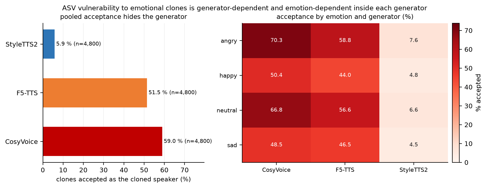
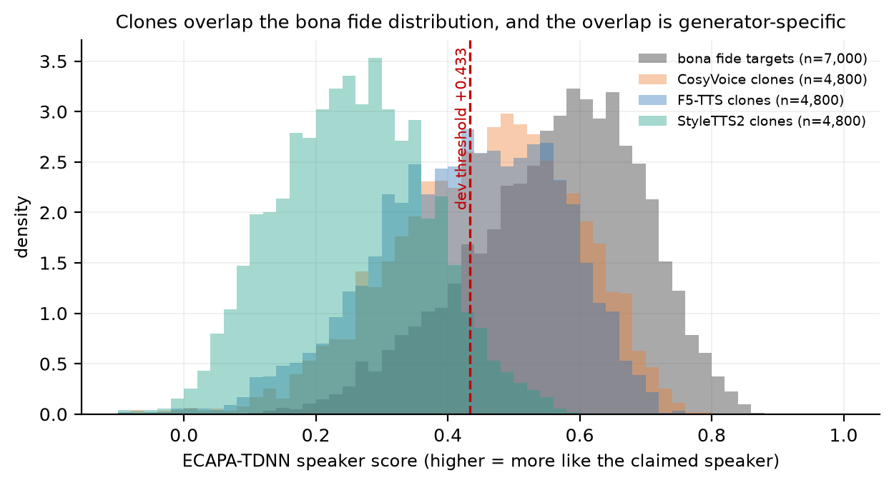
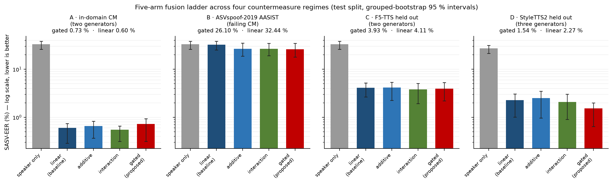
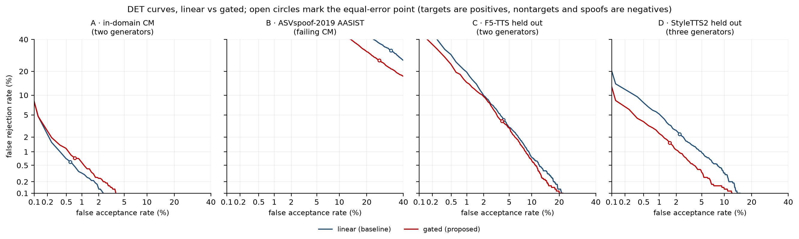
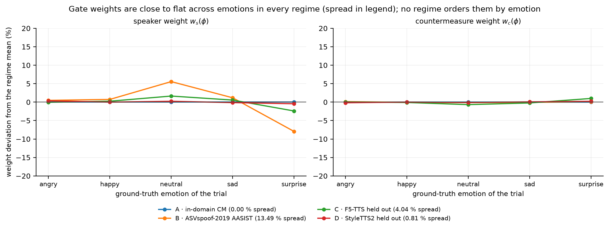

# Emotion-conditioned fusion does not make spoofing-aware speaker verification emotion-aware: a cross-generator measurement study

*Draft — workshop version on the ESD/EmoSpoof-TTS pilot corpus. Every number below
comes from `results/real/*/results.json` and is reproduced in
[docs/REAL_RESULTS.md](../docs/REAL_RESULTS.md). The journal version re-anchors the
same pipeline on CREMA-D; see [docs/CORPUS_STRATEGY.md](../docs/CORPUS_STRATEGY.md).*

## Abstract

Spoofing-aware speaker verification (SASV) combines a speaker front-end with a
countermeasure so that a system rejects both an impostor and a synthetic voice
claiming a genuine user. Emotional speech is usually treated as nuisance variation,
and a recent line of work proposes the opposite: condition the fusion decision on the
speaker's emotion, on the theory that some emotions make clones harder to detect.
We test that proposal directly. On 53,900 trials built from ESD bona fide speech and
36,000 neural clones from three generators (StyleTTS2, F5-TTS, CosyVoice), we run a
five-arm fusion ladder — plain fusion, additive emotion features, bilinear
interaction, and an emotion-conditioned gate — under four countermeasure regimes,
and then interrogate the mechanism three ways. Three findings survive. First, the
speaker front-end's vulnerability is generator-specific in a way the pooled rate
hides: it accepts 38.8 % of clones overall, but 5.9 % of StyleTTS2 clones and
51.5–59.0 % of F5-TTS and CosyVoice clones. Second, countermeasure transfer is
governed by generator adjacency rather than by ASVspoof lineage: an official
ASVspoof-2019 AASIST scores at chance (50.8 % EER) on these clones, and the same
architecture retrained in-domain on ASVspoof 2019 LA still scores 43.8 %, while a
small log-mel CNN trained on two adjacent generators detects the third at 2.50 %.
Third, the proposed mechanism does not hold: the gate's learnt weights are flat
across emotions, replacing the emotion vector with a single SER confidence scalar
reproduces the gated arm's entire advantage (1.49 % vs 1.54 % SASV-EER, p = 0.76),
and excluding an emotion from both training and fusion costs nothing on that
emotion (≤ 0.03 points). The gated arm *is* the best model on the three-generator
corpus, but for a reason that has nothing to do with emotion. We report the
measurement rather than the method: emotion-conditioned fusion, as instantiated
here, buys capacity and calibration, and its apparent gain under a failing
countermeasure is partly a spoof cue leaking through an out-of-domain emotion
recogniser.

## 1. Introduction

A speaker verification system answers one question: is this the claimed speaker? A
spoofing-aware system must answer two, because the claimed speaker may not exist —
a text-to-speech system can produce their voice. SASV therefore fuses speaker
evidence with countermeasure evidence, and the fusion rule is where the research
question lives.

Emotion is a natural axis to condition that rule on. Emotional speech shifts
prosody, energy and spectral tilt; neural clones are synthesised from a reference
recording that also carries an emotion; and anti-spoofing researchers have
repeatedly noted that clone quality and detectability are not uniform across
speaking styles. If some emotions are harder to clone convincingly, or harder to
detect once cloned, then a per-trial weighting of speaker and countermeasure
evidence should beat a fixed weight. The proposal is attractive because it is cheap:
the emotion posterior comes from an off-the-shelf recogniser, and the gate is a
small network on top of scores the system already computes.

This paper asks whether that proposal survives contact with a real cross-generator
corpus, and — this is the part we consider more useful — *why* it does or does not.
We build a five-arm ladder that separates the two things an emotion-conditioned
system can be doing. The additive arm adds emotion information without letting it
change the weighting; the interaction arm allows a bilinear coupling between emotion
and each evidence source, which is pure capacity; the gated arm lets emotion set
per-trial non-negative weights on speaker and countermeasure evidence, which is the
mechanism under test. Comparing adjacent arms tells us whether an observed gain is
emotion *information*, extra *capacity*, or actual *conditioning*.

Three results organise the paper.

**The vulnerability is generator-specific, and the pooled number hides it.** At a
dev-selected threshold, an off-the-shelf ECAPA-TDNN accepts 38.8 % of clones as the
cloned speaker. That aggregate is a mixture: 59.0 % for CosyVoice, 51.5 % for F5-TTS,
and 5.9 % for StyleTTS2. A system evaluated on a pooled clone set would report the
average and miss the mechanism.

**Countermeasure transfer follows generator adjacency, not dataset lineage.** The
official ASVspoof-2019 AASIST checkpoint — a strong LA countermeasure — is at chance
on these clones (50.8 % EER). Retraining the *same* architecture in-domain on
ASVspoof 2019 LA audio produces a working LA detector (2.11 % EER on held-out LA
speakers) that is still at chance on our clones (43.8 %). Meanwhile a deliberately
simple log-mel CNN, trained on two of our three generators, detects the third at
2.50 % EER. What transfers is proximity to the synthesis family, not the provenance
of the countermeasure.

**Emotion conditioning is not the source of the gated arm's advantage.** On the
complete three-generator corpus the gated arm is the best model: 1.54 % SASV-EER
against 2.27 % for plain fusion, a paired gain of 0.68 points (95 % CI 0.15–1.12,
p = 0.002), and it also beats the interaction control by 0.48 points (0.06–0.99).
But its learnt gate weights barely move across emotions (speaker weight 4.02–4.05,
countermeasure weight 9.69–9.73 across five conditions). Replacing the four-way
emotion posterior with a single scalar — the emotion recogniser's maximum
probability — reproduces the entire gain (1.49 % vs 1.54 %, difference 0.02 points,
CI −0.04 to +0.09, p = 0.76). A one-dimensional input cannot condition on emotion. On
a second corpus where the countermeasure fails, emotion features do buy about 5.5
points, but the same ablation shows a third of that is the recogniser being
confidently wrong on synthetic speech, i.e. an implicit spoof cue; and excluding an
entire emotion from the countermeasure's training *and* from the fusion fit costs
0.03 points or less on that emotion, which is what a system that does not use
emotion identity would look like.

We therefore frame the contribution as a measurement study with a negative result
for the mechanism and a positive, reproducible result for the transfer behaviour. The
practical message for SASV design is that the fusion rule should be evaluated
against capacity- and calibration-matched controls, and that countermeasure
provenance is a poor guide to transfer.

## 2. Related work

**Spoofing-aware speaker verification.** The SASV 2022 challenge fixed the task and
its metric: a system is judged on trials that mix target, nontarget and spoof
conditions, scored by SASV-EER and min a-DCF, with countermeasure and speaker
scores combined at the score level [SASV22]. Subsequent work has mostly explored
better front-ends and tighter integration; the fusion rule itself is usually a
fixed or lightly calibrated combination. Our baseline is deliberately that: plain
logistic fusion of speaker and countermeasure scores, fitted on train.

**Countermeasures and their transfer.** AASIST [AASIST] is a strong graph-based
anti-spoofing model and the reference architecture for ASVspoof 2019/2021 LA and DF
tracks. Countermeasure generalisation to unseen attack families is known to be
poor, and the standard response is more diverse training data. Our third finding
refines this for the neural-TTS case: the relevant axis is not the dataset the
countermeasure was trained on but how close the training synthesisers are to the
test ones, which we measure by holding out a generator.

**Emotion in speaker and spoofing research.** Emotional speech degrades speaker
verification and is normally handled by augmentation or by an emotion-independent
embedding. Two recent lines bring emotion into the decision instead: an
utterance-style-dependent verification system that fuses an emotional embedding
with a fixed weight [Sensors25], and GEM, which gates a set of emotion-specialised
anti-spoofing models [Mahapatra25]. GEM is the closest prior work, and the
difference is structural: it has no speaker branch and therefore no SASV decision;
it asks which anti-spoofing expert should speak for a given emotion, not how
emotion should re-weight speaker against countermeasure evidence. Note that GEM and
the corpus we use in this paper come from that same study [Mahapatra25] — the
authors released EmoSpoof-TTS along with their gated ensemble — so "the corpus
paper" and "the closest prior method" are one reference, not two. Neither work reports the
capacity-matched controls that would separate conditioning from capacity, which is
what the ladder in §5 supplies.

**Emotional neural clones.** EmoSpoof-TTS [Mahapatra25] released 36,000 clones of
ten ESD speakers with three open systems and parallel text, which is what makes a
controlled cross-generator comparison possible at all; its own evaluation is
anti-spoofing only, on a speaker- and generator-disjoint split. We use that corpus
and inherit its construction recipe for the re-anchored journal corpus.

## 3. Corpus and protocol

**Corpora.** Bona fide speech is the English subset of ESD [ESD], speakers
0011–0020 (17,900 target trials). Spoofed speech is EmoSpoof-TTS [Mahapatra25]: 36,000
clones of those same ten speakers from StyleTTS2 [StyleTTS2], F5-TTS [F5TTS] and
CosyVoice [CosyVoice], 12,000 per generator, four emotions, parallel text. Emotion
labels are the corpus ground truth, never a model output.

**Trials.** A target trial pairs a genuine recording with a model of its speaker; a
nontarget trial pairs a recording with a different speaker's model; a spoof trial
pairs a clone with the model of the speaker it imitates. Speaker-disjoint 4/2/4
split: train 21,560, dev 10,780, test 21,560 trials. Every fusion parameter and
scaler is fitted on train; thresholds and model selection use dev; test is reported
once. Confidence intervals are grouped bootstrap over claimed speakers (1,000
resamples, seed 7), and arm comparisons are paired on the same resamples.

**Metric.** SASV-EER treats target trials as positives and both nontarget and spoof
trials as negatives; min a-DCF and min t-DCF are reported alongside. Component
diagnostics are SV-EER (bona fide trials only) and SPF-EER (bona fide versus spoof).

**A limitation we state up front.** The pilot corpus has ten speakers, four of them
in the test split, and ESD's research licence was never granted; the audio came from
a public mirror and is used under ESD's stated research-use terms. The journal
version therefore re-anchors the identical pipeline on CREMA-D [CREMAD], which is
released under ODbL 1.0 (no request or signature) and supplies 91 actors — fifteen
in its test partition — with clones regenerated from the same three systems. We
report the pilot here because its conclusions are what the re-anchoring has to
reproduce, and we label every number accordingly.

## 4. Systems

**Speaker front-end.** SpeechBrain ECAPA-TDNN [ECAPA] with cosine scoring to the
train-split centroid. On test it reaches 3.12 % SV-EER and accepts 82.9 % of target
trials.

**Emotion front-end.** wav2vec2-base-superb-er [W2V] as a frozen four-way
classifier (angry, happy, neutral, sad), used as a score producer only. Its
behaviour on this corpus is itself a finding: 41.2 % accuracy on bona fide speech
and 32.8 % on clones, at a mean maximum probability of 0.825. The model is not
merely uncertain on synthetic speech; it is confidently wrong, which is the
precondition for the spoof-cue confound we quantify in §6.4.

**Countermeasures.** Four regimes, differing only in the countermeasure score file:

- **A — in-domain CNN.** Log-mel CNN trained on the train split; 0.09 % SPF-EER.
  Optimistic by construction, since it sees the test generators during training.
- **B — ASVspoof-2019 AASIST.** The official LA checkpoint [AASIST]; 50.8 %
  SPF-EER, i.e. chance.
- **C — F5-TTS held out.** The same CNN trained with one generator excluded from
training and from dev-based early stopping; 6.27 % EER on the held-out generator.
- **D — StyleTTS2 held out, three generators.** The headline regime: 1.60 %
  SPF-EER overall and 2.50 % on the unseen generator.
- **LA-retrained control.** AASIST retrained in-domain on ASVspoof 2019 LA audio:
  2.11 % EER on held-out LA speakers and 43.8 % on our test split.

## 5. Fusion ladder

All five arms consume the same two evidence sources and are fitted identically
(L2-regularised, dev-thresholded, train-only):

1. `speaker_only` — the speaker score alone; a floor, not a candidate.
2. `linear` — logistic fusion of speaker and countermeasure scores. The baseline,
   and the arm any proposed mechanism has to beat.
3. `emotion_additive` — the same model plus the emotion posterior and two
   uncertainty features (entropy, maximum probability). Emotion information without
   conditioning.
4. `emotion_interaction` — bilinear coupling between each evidence source and the
   emotion features. Capacity matched to the gate, mechanism absent.
5. `emotion_gated` — a small network mapping emotion evidence and uncertainty to
   non-negative per-trial weights on the two evidence sources plus an
   emotion-conditioned bias: the proposed mechanism.

Reading the ladder is the method: 3−2 is what emotion *information* is worth, 4−2
is what emotion-shaped *capacity* is worth, and 5−4 is what *conditioning* adds.

## 6. Results

### 6.1 The vulnerability is generator-specific, and the aggregate hides it

The speaker front-end accepts 82.9 % of genuine target trials and 38.8 % of clones
as the cloned speaker at the dev-selected threshold. That single number is a
mixture of three very different systems (Table 1): StyleTTS2 clones almost never
pass (5.9 %), while F5-TTS and CosyVoice clones pass more than half the time
(51.5 % and 59.0 %). Any conclusion drawn from a pooled clone set is therefore a
conclusion about its mixture, which is why every downstream result in this paper is
reported per generator.

**Table 1. ASV acceptance of clones at the dev-selected threshold (test split).**

| generator | n | accepted | mean speaker score |
|---|---:|---:|---:|
| CosyVoice | 4,800 | 59.0 % | +0.455 |
| F5-TTS | 4,800 | 51.5 % | +0.430 |
| StyleTTS2 | 4,800 | **5.9 %** | +0.256 |
| pooled | 14,400 | 38.8 % | — |

Inside each generator the emotion ordering is stable: angry clones are accepted
most often and happy/sad least. CosyVoice runs 70.3 / 66.8 / 50.4 / 48.5 % for
angry / neutral / happy / sad; F5-TTS 58.8 / 56.6 / 44.0 / 46.5 %; StyleTTS2
7.6 / 6.6 / 4.8 / 4.5 %. The effect is real but its magnitude is set by the
generator: the same emotion moves acceptance by 22 points in one system and by 3
points in another.

**Figure 1. Where the pooled 38.8 % comes from.** Left: spoof acceptance per
generator against the pooled rate. Right: the emotion × generator matrix, which
separates StyleTTS2 (bottom row) instead of averaging it away.

**Figure 2. ECAPA speaker scores per generator** against the dev-selected
threshold. The overlap of the F5-TTS and CosyVoice clone distributions with the
bona-fide one is what makes those two generators dangerous; StyleTTS2 clones sit
mostly below the threshold.

### 6.2 Transfer is governed by generator adjacency, not by dataset lineage

Table 2 places the four countermeasure regimes side by side. The official
ASVspoof-2019 AASIST is at chance on these clones (50.8 % SPF-EER). Retraining the
same architecture in-domain on ASVspoof 2019 LA produces a genuinely working LA
detector — 2.11 % EER on held-out LA speakers — that is *still* at chance on our
test split (43.8 %). What does transfer is a small log-mel CNN trained on two of our
three generators, which detects the third at 2.50 % EER.

**Table 2. Countermeasure regimes (test split).**

| regime | countermeasure | SPF-EER | SASV-EER, gated |
|---|---|---:|---:|
| A | in-domain log-mel CNN (two generators) | 0.09 % | 0.73 % |
| B | ASVspoof-2019 AASIST (official) | 50.8 % | 26.10 % |
| C | CNN with F5-TTS held out | 6.27 % on the unseen generator | 3.93 % |
| D | CNN with StyleTTS2 held out, three generators | 1.60 % overall, 2.50 % unseen | **1.54 %** |
| control | AASIST retrained on ASVspoof 2019 LA | 2.11 % on LA, 43.8 % on ours | — |

### 6.3 The gated arm wins only where the countermeasure is hard, and that win is
not the mechanism

The ladder behaves differently in each regime, and the differences are the point
(Tables 3 and 4).

**Table 3. SASV-EER (%) on the test split, five arms, four regimes.**

| regime | speaker only | linear | additive | interaction | gated |
|---|---:|---:|---:|---:|---:|
| A (in-domain CM) | 33.09 | **0.60** | 0.66 | 0.55 | 0.73 |
| B (failing AASIST) | 33.09 | 32.44 | 26.54 | 26.61 | **26.10** |
| C (F5-TTS held out) | 33.09 | 4.11 | 4.17 | **3.81** | 3.93 |
| D (StyleTTS2 held out) | 27.12 | 2.27 | 2.51 | 2.09 | **1.54** |

**Table 4. Paired contrasts (SASV-EER points, grouped bootstrap over claimed
speakers; positive = first arm better).**

| comparison | regime | gain | 95 % CI | p |
|---|---|---:|---|---:|
| gated vs linear | A | −0.14 | −0.28 … −0.00 | 0.98 |
| gated vs linear | B | +5.57 | +2.86 … +9.85 | < 0.001 |
| gated vs linear | C | +0.27 | −0.23 … +0.86 | 0.23 |
| gated vs linear | D | +0.68 | +0.15 … +1.12 | 0.002 |
| interaction vs linear | D | +0.20 | +0.03 … +0.62 | — |
| gated vs interaction | D | +0.48 | +0.06 … +0.99 | — |
| gated vs additive | D | +0.85 | +0.25 … +1.46 | — |

Both contrasts hold across seeds: the gated arm is best in all four seeds in regime
D (1.40–1.54 %) and worse than plain fusion in all four in regime A (0.73–0.79 %
against 0.60 %), so the regime-dependent sign flip is not an artefact of one
initialisation.

**Figure 3. SASV-EER of the five arms with grouped-bootstrap 95 % intervals, one
panel per countermeasure regime.** The sign flip between regimes is the result: the
proposed arm is last where the countermeasure works and first where it is weakened.

**Figure 4. DET curves for `linear` and `emotion_gated` per regime** (probit axes,
open circles at the equal-error point). Every crossing reproduces the SASV-EER in
Table 3 to the second decimal, which is an independent check on the metric code.

Two further ablations test how much of the ladder's behaviour is an artefact of the
chosen fitting setup. Removing the entropy and confidence features changes no arm by
more than 0.03 points in either decision regime (regime D gated 1.55 % against
1.54 %), so the uncertainty encoding is inert here — consistent with the single
scalar already reproducing the gated arm's edge (§6.4). Replacing the dev-EER
threshold with a security-budget rule (the most permissive dev threshold whose
dev false-accept rate stays under 1 %) leaves the arm ordering intact while moving
the operating point: plain fusion is still best in regime A (1.23 % FRR against
1.96 % for the gated arm) and the gated arm still best in regime D (6.86 % FRR
against 10.83 % for plain fusion and 10.81 % for the interaction control). In regime
A the gated arm falls to fourth place on FRR at the budget (1.96 %, against 1.23 %
for plain fusion), so the regime A verdict is slightly stronger under this rule than
at the EER point. The margins are threshold-dependent even though their sign is not,
which is one more reason to read the regime D win as capacity and calibration
rather than mechanism.

Where the countermeasure already works, emotion conditioning is unnecessary and
the proposed arm is slightly worse than plain fusion (regime A: −0.14 points).
Where the countermeasure fails outright, emotion features help a lot (+5.57) — but
§6.4 shows that this is not emotion semantics. Only in the cross-generator regime
is the gated arm the best model, and it is best against *every* control, including
the interaction arm that shares its capacity but not its mechanism.

### 6.4 Why the win is not emotion conditioning: three independent probes

**Probe 1 — the gate does not vary with emotion.** The learnt per-trial weights,
averaged by ground-truth emotion, span 4.02–4.05 for the speaker branch and
9.69–9.73 for the countermeasure branch across five emotions. In regime A they are
identical to four decimal places. A mechanism whose whole purpose is per-emotion
weighting that produces a single global weight is a single global weight with extra
steps.

**Figure 5. The negative result in one image.** Learned gate weights by ground-truth
emotion, for the speaker branch (left) and the countermeasure branch (right), one
line per regime, plotted as percentage deviations from each regime's own mean so
that four regimes share a scale. The spread in the legend is the total range across
emotions; no regime orders its weights by emotion.

**Probe 2 — a single scalar replaces the emotion vector.** We refit every arm with
the four-way posterior replaced by one number: the emotion recogniser's maximum
probability. In regime D the gated arm reaches 1.49 % against 1.54 % with the full
vector — a difference of 0.02 points, CI −0.04 to +0.09, p = 0.76. One input cannot
condition on four classes, so the advantage is capacity and calibration on a single
spoof-correlated feature. The interaction arm behaves differently and does need the
vector (it loses 0.19 points without it, CI −0.59 to +0.03, p = 0.046), which is why
the two emotion arms cannot be discussed as one.

In regime B the same ablation splits the +5.57 into roughly one third spoof cue
(the scalar alone recovers +1.6 points, p < 0.001) and two thirds per-class
out-of-domain behaviour (the full vector beats the scalar by 3.68 points, CI −7.68
to −0.78). Given a recogniser that is 32.8 % accurate on clones at 0.825
confidence, the honest reading of the residual is *which wrong label was chosen
confidently*, not *which emotion the speaker felt*.

**Probe 3 — remove an emotion from the fit and nothing changes.** Excluding `angry`,
then `neutral`, from both the countermeasure's training and dev-based early
stopping *and* from the fusion fit's train/dev, while leaving the test split intact,
changes SASV-EER on that emotion's own 5,040 test trials by at most 0.03 points
(gated: −0.01, CI −0.06 to +0.00, p = 0.77 for angry; +0.03, CI 0.00 to +0.13,
p = 1.00 for neutral); the held-out countermeasure detects the unseen emotion at
0.03 % EER. The method transfers to an unseen emotion — but only because there was
almost no emotion-specific structure to lose.

## 7. Discussion

Three conclusions follow, in decreasing order of confidence.

**Countermeasure provenance is a poor guide to transfer.** The single most
practical result here is negative: a checkpoint from the benchmark that defines the
field is at chance on a modern open-source cloning system, and retraining it on
the same benchmark does not fix that. What fixes it is training on an adjacent
synthesis family. This has a corollary for how SASV papers report component
quality: LA numbers do not predict clone numbers, so both must be reported, and the
reported set should name the generators.

**Emotion-conditioned fusion, as instantiated here, is capacity and calibration.**
The ladder localises the effect precisely: the gain appears only in the regime with
the most heterogeneous evidence, it survives a one-dimensional input, and the learnt
weights do not move. That is the signature of a more flexible decision function,
not of an emotion-aware one. The practical recommendation is methodological — any
emotion-conditioned arm should be reported against a capacity-matched interaction
arm and an information-matched additive arm, because the three are routinely
conflated.

**Out-of-domain emotion recognisers are a spoof detector in disguise.** On clones
the SER is confidently wrong, so its probability vector carries information about
syntheticness. This is a confound for any study that uses SER features in a spoofing
task and does not ablate them, and it is why we report the confidence-scalar
ablation rather than the headline gain. It is also a hint: an explicit, calibrated
out-of-domain signal may be more useful than the emotion labels it replaced.

## 8. Limitations

* **One pilot corpus, ten speakers, four in test.** The grouped bootstrap resamples
  four clusters; every interval in this paper is therefore optimistic in width. The
  journal version replaces this corpus with CREMA-D (91 actors, fifteen in test) and
  re-runs the identical pipeline.
* **Licence.** ESD's research licence was requested but not granted; the audio came
  from a public mirror and is used under ESD's stated research-use terms. No audio
  is redistributed. The journal corpus is ODbL-licensed precisely to remove this
  caveat.
* **No published-baseline reproduction under a matched protocol.** AASIST appears
  as a transfer control, not as a reproduced state-of-the-art SASV system, so the
  absolute numbers here are not comparable to challenge results.
* **One speaker split, four seeds.** The fits were repeated on four seeds in the two decisive
  regimes: the gated arm is best in all four in regime D (1.40–1.54 %) and worse
  than plain fusion in all four in regime A, so the ordering is not an artefact of
  one initialisation. Only the gated arm is seed-sensitive, because the other three
  are fitted by convex procedures. A second speaker split is a property of the
  corpus, not of the seed — which is the fourth reason the journal version moves to
  91 actors.
* **Held-out-emotion folds were run only against a working countermeasure**, so they
  stress the fusion stage, not the countermeasure's emotion generalisation.

## 9. Conclusion

We set out to test whether emotion-conditioned gating improves spoofing-aware
speaker verification on emotional neural clones. It does not: the gate's weights are
flat, its apparent advantage survives the replacement of the emotion vector with a
single scalar, and deleting an entire emotion from training changes nothing on that
emotion. What the study does establish is a measurement: ASV vulnerability to
emotional clones is generator-specific, countermeasure transfer follows generator
adjacency rather than benchmark lineage, and emotion features in a failing-
countermeasure regime partly act as an out-of-domain spoof cue. Those three
findings, with the ladder and the three mechanism probes, are the contribution; the
proposed architecture is reported as a better-calibrated decision function and not
as an emotion-aware one.

## Data and ethics statement

Bona fide speech is ESD English (research use, licence requested, not
redistributed). Spoofed speech is EmoSpoof-TTS, CC BY 4.0. Clones imitate real
speakers and are used only to simulate attacks; no cloned audio is released, no
attempt is made to impersonate, and all reported artefacts are trial manifests,
aggregate metrics and per-trial scores. The journal version uses CREMA-D under
ODbL 1.0 / DbCL 1.0, whose terms cover the database rather than the actors'
personality rights; clones are generated locally with open systems (StyleTTS2, MIT;
F5-TTS, MIT code with CC BY-NC weights, non-commercial research only; CosyVoice,
Apache-2.0), synthesised samples are disclosed as synthetic, and no generated audio
is distributed.

## References

Metadata verified against the publisher or archive record on 2026-10-25 (DOI given
for each). No entry is cited from memory; where a work exists in two forms (the SASV
2022 challenge paper and its evaluation plan) both are named.

* [SASV22] J.-w. Jung, H. Tak, H.-j. Shim, H.-S. Heo, B.-J. Lee, S.-W. Chung,
  H.-G. Kang, H.-J. Yu, N. Evans, T. Kinnunen, "SASV 2022: The first spoofing-aware
  speaker verification challenge," *Interspeech 2022*, pp. 2893–2897.
  doi:10.21437/Interspeech.2022-11270. Evaluation plan: arXiv:2201.10283.
* [AASIST] J.-w. Jung, H.-S. Heo, H. Tak, H.-j. Shim, J. S. Chung, B.-J. Lee,
  H.-J. Yu, N. Evans, "AASIST: audio anti-spoofing using integrated spectro-temporal
  graph attention networks," *ICASSP 2022*, pp. 2405–2409.
  doi:10.1109/ICASSP43922.2022.9747766.
* [ECAPA] B. Desplanques, J. Thienpondt, K. Demuynck, "ECAPA-TDNN: emphasized
  channel attention, propagation and aggregation in TDNN based speaker
  verification," *Interspeech 2020*, pp. 3830–3834. doi:10.21437/Interspeech.2020-2650.
* [W2V] A. Baevski, Y. Zhou, A. Mohamed, M. Auli, "wav2vec 2.0: a framework for
  self-supervised learning of speech representations," *NeurIPS 33* (2020);
  arXiv:2006.11477. Emotion labels come from the `superb/wav2vec2-base-superb-er`
  checkpoint of the SUPERB benchmark (Yang et al., *Interspeech 2021*).
* [Mahapatra25] A. Mahapatra, I. R. Ulgen, A. R. Naini, C. Busso, B. Sisman, "Can
  emotion fool anti-spoofing?", *Interspeech 2025*, pp. 5628–5632.
  doi:10.21437/Interspeech.2025-1234. This single paper introduces both
  **EmoSpoof-TTS** (the 36,000-clone corpus used here, CC BY 4.0, Zenodo
  15557842) and **GEM** (the gated ensemble of emotion-specialised anti-spoofing
  models that is our closest prior method).
* [Sensors25] L. Pham Hoang, H. Takayama, M. Nishida, S. Tsuge, S. Kuroiwa,
  "Utterance-style-dependent speaker verification using emotional embedding with
  pretrained models," *Sensors* 25(17), art. 5284, 2025. doi:10.3390/s25175284.
* [ESD] K. Zhou, B. Sisman, R. Liu, H. Li, "Emotional voice conversion: theory,
  databases and ESD," *Speech Communication* 137, 1–18, 2022.
  doi:10.1016/j.specom.2021.11.006. English subset; the corpus download page asks
  users to cite the ICASSP 2021 paper (arXiv:2010.14794) and licenses the database
  "free to use only for research purpose".
* [CREMAD] H. Cao, D. G. Cooper, M. K. Keutmann, R. C. Gur, A. Nenkova, R. Verma,
  "CREMA-D: crowd-sourced emotional multimodal actors dataset," *IEEE Transactions
  on Affective Computing* 5(4), 377–390, 2014. doi:10.1109/TAFFC.2014.2336244.
  Released under ODbL 1.0 with contents under DbCL 1.0.
* [StyleTTS2] Y. A. Li, C. Han, V. S. Raghavan, G. Mischler, N. Mesgarani,
  "StyleTTS 2: towards human-level text-to-speech through style diffusion and
  adversarial training with large speech language models," *NeurIPS 36* (2023),
  pp. 19594–19621; arXiv:2306.07691.
* [F5TTS] Y. Chen, Z. Niu, Z. Ma, K. Deng, C. Wang, J. Zhao, K. Yu, X. Chen,
  "F5-TTS: a fairytaler that fakes fluent and faithful speech with flow matching,"
  *ACL 2025 (Long Papers)*, pp. 6255–6271; arXiv:2410.06885.
* [CosyVoice] Z. Du, Q. Chen, S. Zhang, K. Hu, H. Lu, Y. Yang, H. Hu, S. Zheng,
  Y. Gu, Z. Ma, Z. Gao, Z. Yan, "CosyVoice: a scalable multilingual zero-shot
  text-to-speech synthesizer based on supervised semantic tokens,"
  arXiv:2407.05407, 2024 (preprint; no proceedings version found).

